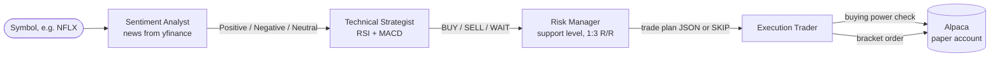

# Algotrading Agents Crew

A multi-agent trading system built with **CrewAI**: four specialised LLM agents work as a team – news analyst, technical strategist, risk manager and execution trader – and place real **bracket orders on an Alpaca paper-trading account**.

> **Paper trading only.** This is an educational project, not financial advice. The execution client is hard-wired to Alpaca's paper environment (`paper=True`).

<!-- TODO: add a screenshot of a run log and of the Alpaca paper dashboard, e.g. docs/run.png -->

## How it works



The crew runs **sequentially** and every task receives the previous agents' output as context:

| Agent | Tools | Decision logic |
|---|---|---|
| **Senior Market News Analyst** | `fetch_stock_news` (yfinance, last 4 days) | Filters noise, extracts catalysts (earnings, upgrades, macro), outputs a sentiment label |
| **Technical Indicator Specialist** | `get_historical_data`, `calculate_indicators` (pandas-ta) | Rule-based signal from RSI (oversold / overbought) and MACD trend, checked against the sentiment result → BUY / SELL / WAIT |
| **Risk & Strategy Manager** | `find_support_level`, `calculate_risk_parameters` | Stop loss 2% below the 30-day support, take profit at 3× the risk (1:3 R/R), position size of $20,000 |
| **Head of Execution** | `get_buying_power`, `submit_bracket_order` (alpaca-py) | Verifies the plan and funds, then sends a market entry with attached take-profit and stop-loss orders |

**Engineering details**
- Tools are typed with `Annotated` + Pydantic `Field` descriptions so the LLM calls them with valid arguments.
- Market data and news are cached per hour on disk (`diskcache`) to save API calls between runs.
- Alpaca calls go through a sliding-window **rate limiter** (`core/rate_limiter.py`, built test-first).
- Structured logging to the console and `logs/trading.log`.
- Agents are constrained with `max_iter` and strict output formats so the hand-off between agents is machine-readable.

## Getting started

**Requirements:** Python 3.12 or 3.13 (required by pandas-ta and CrewAI), an OpenAI API key and free [Alpaca paper trading](https://alpaca.markets/) API keys.

```bash
git clone https://github.com/OfekZagury/Algotrading-Agents-Crew.git
cd Algotrading-Agents-Crew
python -m venv .venv
source .venv/bin/activate          # Windows: .venv\Scripts\activate
pip install -r requirements.txt
cp .env.example .env               # add your keys
```

Run the crew for one or more symbols:

```bash
python -m Agents.agent_trader NFLX PLTR
```

Without arguments it uses `TRADING_SYMBOLS` from `.env` (default `NFLX`).

## Tests

```bash
pytest
```

## Project structure

```
Agents/
├── agent_trader.py          # entry point: tasks, crew assembly, run loop
├── Crew_Configuration.py    # agent roles, goals and backstories
└── Tools/                   # sentiment, technical, risk and execution tools
core/
├── logger.py
└── rate_limiter.py
Tests/
└── test_rate_limiter.py
```

## Configuration

| Variable | Purpose |
|---|---|
| `OPENAI_API_KEY` | LLM for all agents |
| `OPENAI_MODEL` | Model name (default `gpt-5`) |
| `ALPACA_API_KEY` / `ALPACA_SECRET_KEY` | Alpaca **paper** account keys |
| `TRADING_SYMBOLS` | Comma separated default symbols |
