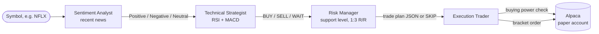

# Algotrading Agents Crew

A multi-agent trading system built with **CrewAI**: four specialised LLM agents work as a team – news analyst, technical strategist, risk manager and execution trader – and place real **bracket orders on an Alpaca paper-trading account**.

> **Paper trading only.** This is an educational project, not financial advice. The execution client is hard-wired to Alpaca's paper environment (`paper=True`).

**[▶ Live demo](https://algotrading-agents-crew.streamlit.app/)**: a **web UI** (`streamlit_app.py`) where you pick a stock, press *Run the crew* and watch each agent's result appear as soon as it finishes. The web UI always runs in simulation mode, so the execution agent builds the bracket order but never sends it.

## How it works



The crew runs **sequentially** and every task receives the previous agents' output as context:

| Agent | Tools | Decision logic |
|---|---|---|
| **Senior Market News Analyst** | `fetch_stock_news` (Yahoo Finance, last 4 days) | Filters noise, extracts catalysts (earnings, upgrades, macro), outputs a sentiment label |
| **Technical Indicator Specialist** | `get_historical_data`, `calculate_indicators` (pandas-ta) | Rule-based signal from RSI (oversold / overbought) and MACD trend, checked against the sentiment result → BUY / SELL / WAIT |
| **Risk & Strategy Manager** | `find_support_level`, `calculate_risk_parameters` | Stop loss 2% below the 30-day support, take profit at 3× the risk (1:3 R/R), position size of $20,000 |
| **Head of Execution** | `get_buying_power`, `submit_bracket_order` (alpaca-py) | Verifies the plan and funds, then sends a market entry with attached take-profit and stop-loss orders |

**Engineering details**
- **Two LLM providers:** Google Gemini when `GEMINI_API_KEY` is set (default `gemini-3.5-flash-lite`), otherwise OpenAI (`OPENAI_MODEL`, default `gpt-5`).
- **Data fallbacks** (`Agents/Tools/market_data.py`): prices come from Yahoo Finance, falling back to Alpaca's IEX market data; news comes from Yahoo Finance, falling back to Google News RSS. Cloud hosts are often rate-limited by Yahoo, so the crew keeps working there.
- **Simulation mode:** with `DRY_RUN=true` the execution agent validates the plan and returns a simulated bracket order instead of sending it to Alpaca.
- Tools are typed with `Annotated` + Pydantic `Field` descriptions so the LLM calls them with valid arguments.
- Market data and news are cached per hour on disk (`diskcache`) to save API calls between runs.
- Alpaca calls go through a sliding-window **rate limiter** (`core/rate_limiter.py`, built test-first).
- Structured logging to the console and `logs/trading.log`.
- Agents are constrained with `max_iter` and strict output formats so the hand-off between agents is machine-readable.

## Getting started

**Requirements:** Python 3.12 or 3.13 (required by pandas-ta and CrewAI), a [Gemini](https://aistudio.google.com/apikey) or OpenAI API key, and free [Alpaca paper trading](https://alpaca.markets/) API keys.

```bash
git clone https://github.com/OfekZagury/Algotrading-Agents-Crew.git
cd Algotrading-Agents-Crew
python -m venv .venv
source .venv/bin/activate          # Windows: .venv\Scripts\activate
pip install -r requirements.txt
cp .env.example .env               # add your keys
```

Run the crew for one or more symbols:

```bash
python -m Agents.agent_trader NFLX PLTR
```

Without arguments it uses `TRADING_SYMBOLS` from `.env` (default `NFLX`).

Or start the web UI (simulation mode, nothing is sent to Alpaca):

```bash
streamlit run streamlit_app.py
```

### Deploying the web UI

The web UI runs on [Streamlit Community Cloud](https://share.streamlit.io) for free:

1. *Create app* → this repository, branch `master`, main file `streamlit_app.py`.
2. *Advanced settings* → Python 3.12 or 3.13, and add the secrets:
   ```toml
   GEMINI_API_KEY = "..."
   GEMINI_MODEL = "gemini-3.5-flash-lite"
   # optional, used as the price source when Yahoo Finance is rate-limited
   ALPACA_API_KEY = "..."
   ALPACA_SECRET_KEY = "..."
   ```

To keep API costs predictable, each visitor gets 3 runs per session, the whole app is capped at 40 runs a day, and a symbol's result is reused for an hour.

## Tests

```bash
pytest
```

## Project structure

```
streamlit_app.py             # web UI (simulation mode)
Agents/
├── agent_trader.py          # entry point: tasks, crew assembly, run loop
├── Crew_Configuration.py    # LLM selection, agent roles, goals and backstories
└── Tools/                   # market data, sentiment, technical, risk and execution tools
core/
├── logger.py
└── rate_limiter.py
Tests/
└── test_rate_limiter.py
```

## Configuration

| Variable | Purpose |
|---|---|
| `GEMINI_API_KEY` | Gemini key; when set, all agents use Gemini |
| `GEMINI_MODEL` | Gemini model (default `gemini-3.5-flash-lite`) |
| `OPENAI_API_KEY` | OpenAI key, used when no Gemini key is set |
| `OPENAI_MODEL` | OpenAI model (default `gpt-5`) |
| `ALPACA_API_KEY` / `ALPACA_SECRET_KEY` | Alpaca **paper** account keys (orders and fallback price data) |
| `DRY_RUN` | `true` simulates orders instead of sending them (always on in the web UI) |
| `TRADING_SYMBOLS` | Comma separated default symbols |
